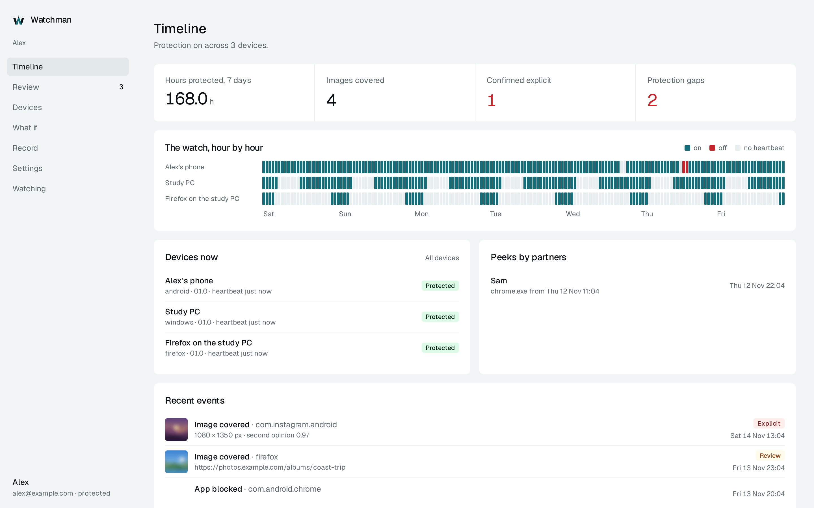
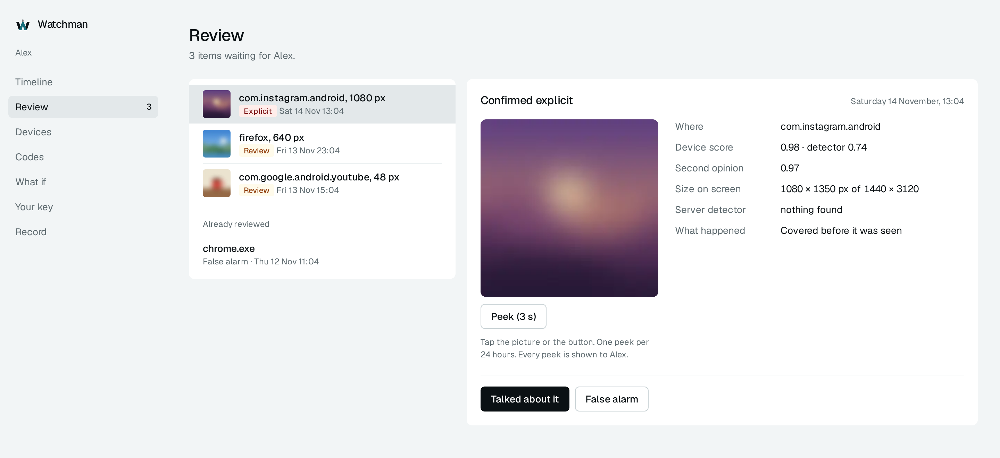
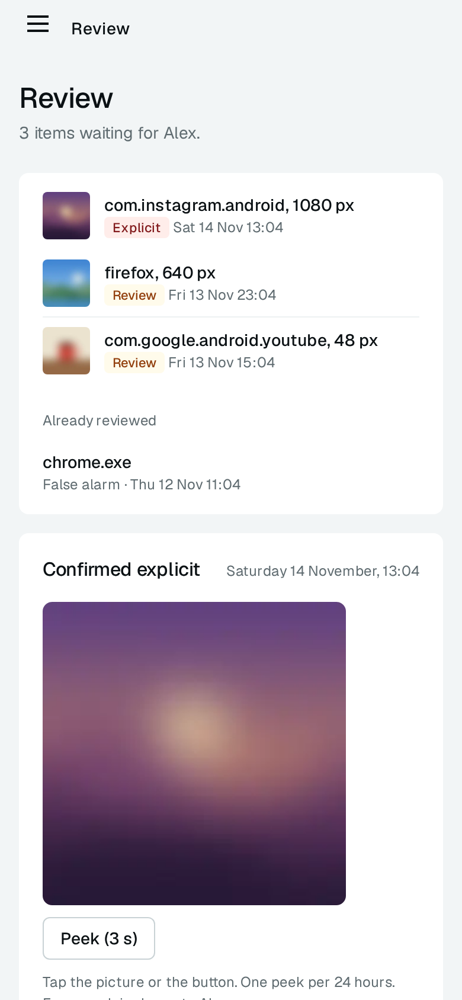
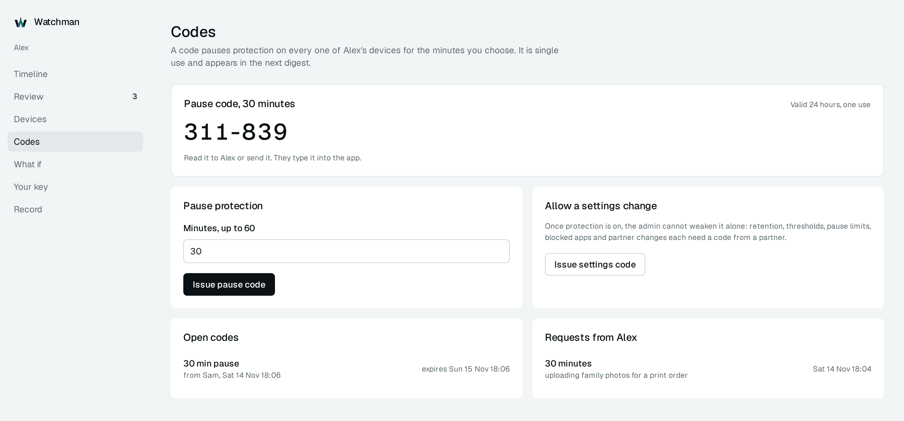
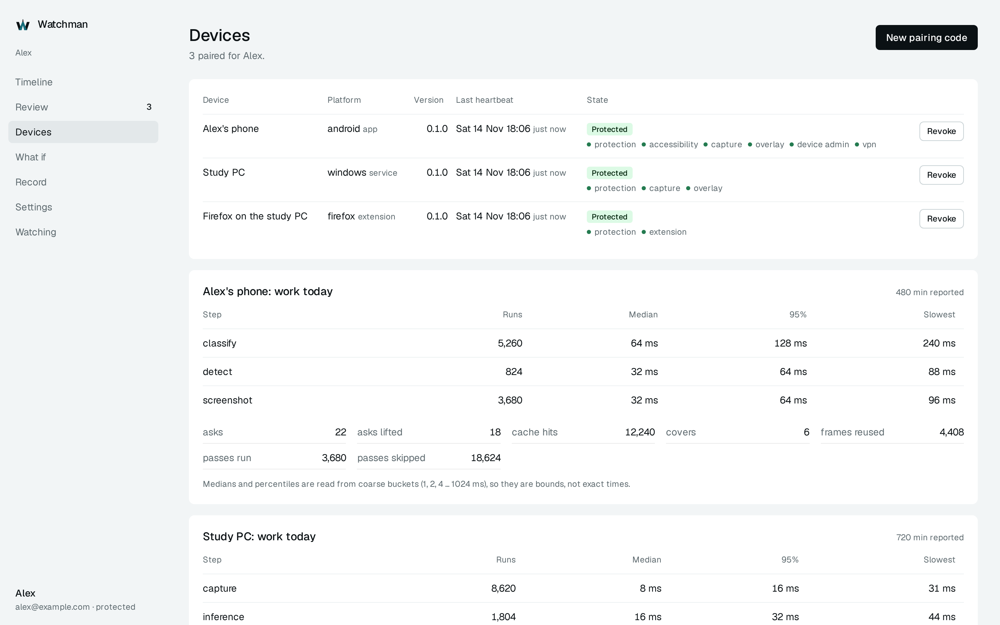
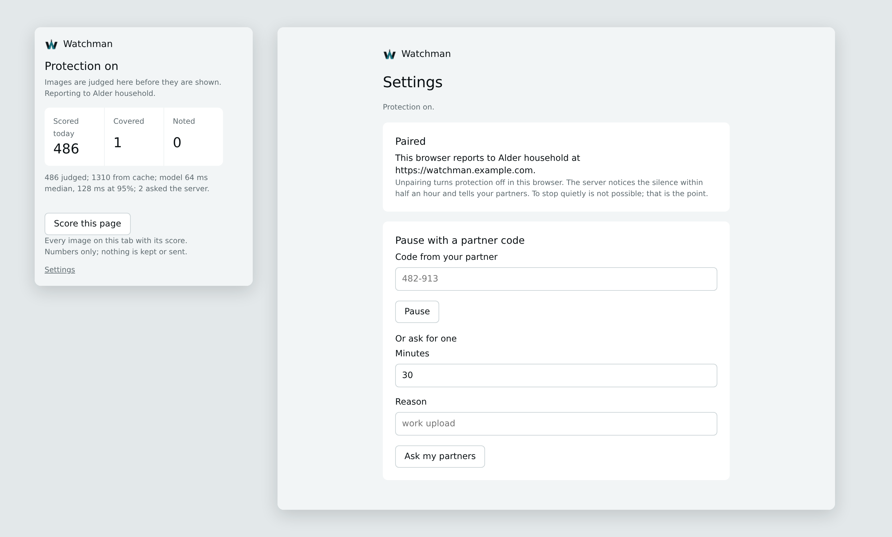

<div align="center">


# Watchman

Self-hosted accountability and real-time image protection for a household,
on your own server, with partners you choose.

[](https://github.com/jbarnell1/watchman/actions/workflows/server.yml)
[](https://github.com/jbarnell1/watchman/actions/workflows/android.yml)
[](https://github.com/jbarnell1/watchman/actions/workflows/extension.yml)
[](LICENSE)
[](https://github.com/jbarnell1/watchman/stargazers)
[](https://github.com/jbarnell1/watchman/commits/main)



<sub>Every screenshot on this page is a throwaway demo server with an invented household. The pictures in it are generated landscapes.</sub>

</div>

## What it is

Watchman is for an adult who wants help staying away from explicit images and has asked one or
more people to walk with them. It judges the images on your screens on the device itself, blurs
explicit ones as they appear, and tells the accountability partners you chose what happened: a
calm weekly digest, and an alert at once when something explicit is confirmed or protection is
turned off.

It is an open alternative to the commercial accountability and filtering apps. The difference is
where things live: each household runs its own server, reachable only on its own Tailscale
tailnet (or behind its own sign-in), and there is no company in the middle and no central service.
The models run locally. Nothing is sent to a cloud AI.

It is early. One household uses it daily on one Android phone and one server; the other clients
build and pass their tests but have seen little real use. See [Project status](#project-status-and-roadmap).

## Who this is for, and consent

Watchman is built for adults who choose accountability for themselves and pick their own partners.
It is not a tool for watching someone who has not agreed, and it has no hidden mode.

What that means in the code today:

- **The person being protected can always see it.** The Android app has a launcher icon and a
  permanent notification, the Windows helper sits in the tray, the browser extension has a toolbar
  popup. Setting a device up means unlocking it and granting each permission by hand.
- **The protected person sees what partners see.** They get the same digests and alerts, they see
  their own timeline on the portal, and every time a partner peeks at a picture it is listed there
  with the partner's name.
- **Partners never see an original image.** The server keeps only two blurred versions of a
  flagged crop and never writes the original to disk. Partners see the heavy blur. A linked partner
  may look at the lighter blur for at most 3 seconds, once per 24 hours by default.
- **Pausing needs a partner.** A pause comes only from a one-time code that a partner issues. The
  protected person cannot issue one, and there is no admin pause button.
- **Turning it off is loud, not impossible.** A device that goes silent, loses a permission or is
  removed raises an alert to the protected person and every partner (on the portal, and by email
  once email is set up). Nothing stops the owner of a device from uninstalling the app.
- **No company sees anything.** The household runs the server. What leaves it is listed under
  [What leaves your server](#what-leaves-your-server).

What the code cannot do is check that consent was given. That part is yours: everyone whose
screens are watched should know, agree, and choose their partners. If that is not the case, do
not install it. Monitoring another adult without their knowledge is against the law in many places.

Limits worth knowing before you rely on it: the settings locks that stop the admin from quietly
loosening protection are off until the household turns them on (every loosening still alerts
everyone), and a person who controls the server can do more than a person who does not. The
threat model in [docs/ARCHITECTURE.md](docs/ARCHITECTURE.md) says what is and is not covered.

## Features

- **Every image judged at its own size.** Clients find the pictures on screen (accessibility tree,
  DOM, or screen tiles) and score each one, so a small avatar is not lost in a whole-screen guess.
- **Blur before you see it.** The browser extension holds each image back until it is scored. On
  Android and Windows an overlay patch covers just the offending picture.
- **A second opinion on your server.** A flagged crop goes to a larger model on the household
  server, which sorts confirmed explicit from false alarm before partners hear about it.
- **Partners see blur, never the picture.** A review page with a heavy blur, a short timed peek at
  a lighter one, and two buttons: talked about it, or false alarm.
- **Calm reports.** A weekly digest by email with counts first and detail below, and alerts only
  for confirmed explicit content and for protection going off.
- **Pauses by partner code.** Need an hour for something legitimate? Ask from the device, a
  partner issues a one-time code, and the pause shows up in the next digest.
- **Hard to loosen quietly.** Optional locks make every weakening of a setting need a partner.
  Partners can hold their own keys, and a hash-chained record shows if the database was edited.
- **Yours to run.** Docker Compose, SQLite, ONNX models on CPU (a GPU is optional). No Watchman
  accounts or passwords: sign-in comes from your tailnet or your own identity provider. No telemetry.

<table>
<tr>
<td width="72%"></td>
<td></td>
</tr>
<tr>
<td colspan="2"><sub>What a partner sees: the heavy blur, the scores, where it happened. The peek shows a lighter blur for 3 seconds and is logged.</sub></td>
</tr>
</table>



<sub>A partner issues a one-time pause code. The request on the right came from the protected person's device.</sub>



<sub>Devices, their protection state, and how much work each one did today (counts and milliseconds only).</sub>



<sub>The browser extension: its popup and its settings page.</sub>

## Quick start

### Look at it first (demo data, Docker only)

The server ships a development mode with fake sign-in and an example household. It needs no
Tailscale account and no models:

```bash
git clone https://github.com/jbarnell1/watchman.git
cd watchman
docker build -t watchman-server ./server
docker run --rm -p 127.0.0.1:8035:8035 -e WATCHMAN_DEV_HOST=0.0.0.0 watchman-server python -m app.devserver
```

Give it about ten seconds to seed, then open <http://127.0.0.1:8035>. Switch who you are with
`/dev/as/owner` (the protected person and admin), `/dev/as/sam` (a linked partner) and
`/dev/as/pat` (an email-only partner). The data is thrown away when the container stops. Keep it
on loopback as shown: this mode has no real sign-in.

### Run it for your household

You need one always-on machine with Docker and the Compose plugin, git, Python 3 or uv (for the
model download), and a free [Tailscale](https://tailscale.com) account with an auth key. A GPU is
not needed.

```bash
git clone https://github.com/jbarnell1/watchman.git
cd watchman
./scripts/setup.sh
```

On Windows with Docker Desktop, run `scripts\setup.ps1` in PowerShell instead. The script writes
`.env`, asks for the Tailscale auth key (or your own OIDC provider), downloads and verifies the
models, and runs `docker compose up -d --build`.

Then open `https://watchman.<your-tailnet>.ts.net` from a device on your tailnet. The first person
to open it becomes the admin and is walked through setup: household name, time zone, the protected
person, the first partner and, if you have one, an SMTP account for email. Create a pairing code
on the Devices page and pair your first device.

Two model files cannot simply be downloaded and need an extra step; the script explains it and
[docs/self-host.md](docs/self-host.md) has the details, along with OIDC sign-in, partners, backups
and updating.

### Get the clients

A server running a release image offers its own version's clients at `/downloads` on the portal,
with no sign-in, so devices install and update from the household's server. The Devices page and
the partner digest name any device running an older version. The same files are on the
[latest release](https://github.com/jbarnell1/watchman/releases/latest); check each against its
`SHA256SUMS`. Each release is built by CI from its tag.

| Client | File | Notes |
|---|---|---|
| Android (11 and later) | `watchman-android-<version>-arm64-v8a.apk` | Most phones. Allow installs from your browser or file manager. [Obtainium](https://github.com/ImranR98/Obtainium) can watch the releases and update it. |
| Windows 10 and 11 | `watchman-windows-<version>-x64.msi` | Not code-signed yet, so Windows asks you to confirm an unknown publisher. Pair it from an elevated prompt as [the runbook](docs/RUNBOOK.md#windows) shows. |
| Chrome, Edge, Brave | `watchman-extension-chrome-<version>.zip` | Unzip, open `chrome://extensions`, turn on Developer mode, Load unpacked. Not in the stores yet. |
| Firefox | `watchman-extension-firefox-<version>.zip` | Not signed by Mozilla yet, so release Firefox loads it only as a temporary add-on. |
| iPhone | none | Build `clients/ios` yourself with Xcode and your own Apple developer account. Safari only. |

Every client can also be built from source; see [docs/RUNBOOK.md](docs/RUNBOOK.md).

[docs/RUNBOOK.md](docs/RUNBOOK.md) has the pairing and permission steps for each one.

## What leaves your server

Nothing goes to the authors of Watchman or to any service they run: there is no telemetry, no
update check and no cloud model. This is the whole list, read from the code.

**What devices send to your server**

- A heartbeat every 5 minutes: which protections are on, battery level, counts and timings of the
  work done, and on Android the names of apps that hide their screen from capture (banking and
  video apps do) with the seconds they were in front.
- An event for each thing that was covered, flagged or blocked: time, app name, for browsers the
  page address and title, the scores, the size on screen and a 64-bit fingerprint of the image.
  Ordinary browsing and app use is not reported.
- The crop of a flagged image, at most 512 pixels on its long side, when the server asks for it.
  Crops the device is unsure about are also sent to be scored and are not kept.

**What your server stores** (all under `./data`)

- A SQLite database: people, partners and their email addresses, devices, heartbeats, events,
  settings, the record of changes, and the SMTP password in plain text if you set one. Protect and
  back up this folder like any other private data.
- Two blurred versions of each flagged crop (256 pixels, AES-GCM encrypted, the key beside them in
  `data/keys`). The original exists only in memory while the second model scores it.
- Retention: blurred images 7 days, events and heartbeats 365 days. Both are settings.

**What partners can see**

- The heavy blur, the app or address, the scores and the time of each item; device states; pauses;
  settings changes. A linked partner (portal access) can also peek at the lighter blur for at most
  3 seconds, once per 24 hours by default. Every peek is logged and shown to the protected person.
- An email-only partner gets the digest and alerts, with heavy blur thumbnails, and nothing else.
- Once partners set up their own keys, page addresses and the lighter blur are sealed so only
  those keys open them.

**Outbound connections the server makes**

| To | When | What |
|---|---|---|
| Your SMTP account | If you configure email | Digests, alerts and pause codes for email-only partners. The mail includes app names, page addresses and heavy blur thumbnails, so your mail provider carries them. |
| An ntfy address | Only if you set one | A one-line push for the admin: device name and what changed, or the app, address and time of a confirmed item. |
| Your OIDC provider | Only in OIDC sign-in mode | The sign-in exchange. |
| Another household's Watchman server | Only if you add one under Watching | Reads that server's record every 5 minutes. |
| Tailscale | In the default mode | The sidecar container joins your tailnet through Tailscale's coordination and relay servers. Tailscale sees device metadata, not the traffic. The HTTPS certificate for the node's `ts.net` name is public, as for any Tailscale HTTPS name. |

**At install time only:** `models/fetch.py` downloads the model files from Hugging Face and
GitHub and checks each against a SHA-256 in `models/manifest.json`, and Docker pulls its base
images. Devices then download their models from your server.

**On the devices:** the clients talk to your server and nothing else, with two exceptions. The
browser extension fetches each image a second time from the site you are on in order to score it.
The Android app's Scan code button uses the QR scanner in Google Play services; typing the code
avoids it.

## Configuration

Process settings live in `.env` (see [.env.example](.env.example)):

| Setting | Default | What it does |
|---|---|---|
| `TS_AUTHKEY` | none, required in Tailscale mode | Auth key that joins the server to your tailnet. |
| `WATCHMAN_NODE_NAME` | `watchman` | The node name, and so the portal address. |
| `TS_EXTRA_ARGS` | empty | Extra `tailscale up` flags, for example a tag. |
| `COMPOSE_FILE` | unset | Set to `compose.yaml:deploy/compose.oidc.yaml` for OIDC sign-in without Tailscale. |
| `WATCHMAN_OIDC_ISSUER`, `WATCHMAN_OIDC_CLIENT_ID`, `WATCHMAN_OIDC_CLIENT_SECRET`, `WATCHMAN_OIDC_REDIRECT_URL` | unset | Your OpenID Connect provider, in OIDC mode. |
| `WATCHMAN_PUBLISH` | `127.0.0.1:8030` | Where your reverse proxy reaches the server, in OIDC mode. |
| `WATCHMAN_SESSION_HOURS` | `168` | How long an OIDC sign-in lasts. |

Everything about the household is a setting on the portal, not a file. The ones that matter most:

| Setting | Default | What it does |
|---|---|---|
| Digest day and time | Sunday 19:00 | When the weekly email goes out, in the household time zone. |
| Image retention | 7 days | How long blurred images are kept. |
| Event retention | 365 days | How long events and heartbeats are kept. |
| Posture | cover and ask the server | Report only, cover on the device, or cover and ask the server about unsure images. |
| Coverage | explicit | Which detector labels count: explicit, revealing or strict. |
| Covered pictures reach partners | when the server finds bare nudity | Or every covered picture. |
| Longest pause | 60 minutes | The cap on a partner's pause code. |
| Silence alert | 30 minutes | How long a device may be quiet before everyone is told. |
| Peek | 3 seconds, once per 24 hours | The lighter blur for linked partners. |
| Locks | off | When on, loosening a locked setting needs a partner. |

The full list with comments is [server/app/settings.py](server/app/settings.py). To use an NVIDIA
GPU for the second opinion, add `compose.gpu.yaml` as described in [docs/self-host.md](docs/self-host.md).

## Documentation

| Document | What it answers |
|---|---|
| [docs/self-host.md](docs/self-host.md) | How do I install it, add partners and devices, back it up and update it? |
| [docs/RUNBOOK.md](docs/RUNBOOK.md) | How do I operate the server and build, install and debug each client? |
| [docs/ARCHITECTURE.md](docs/ARCHITECTURE.md) | What are the parts, how does an image move through them, and what is the threat model? |
| [docs/DECISIONS.md](docs/DECISIONS.md) | Why does it work this way? Every decision, newest first. |
| [docs/api-contract.md](docs/api-contract.md) | What do devices and the server say to each other? |
| [docs/models.md](docs/models.md) | Which models, where they come from, how they are verified and evaluated. |
| [docs/ROADMAP.md](docs/ROADMAP.md) | What is built and what is next? |
| [docs/THIRD_PARTY.md](docs/THIRD_PARTY.md) | Whose code and models does it use, under which licences? |
| [CONTRIBUTING.md](CONTRIBUTING.md), [SECURITY.md](SECURITY.md) | How to help, and how to report a vulnerability. |

## Project status and roadmap

Early releases, used by one household. Expect rough edges.

| Part | Status | What works | What is missing |
|---|---|---|---|
| Server | Working | Device API, portal, second opinion, blur store, digests and alerts, pause and settings codes, partner keys, the hash-chained record. In daily use by one household. | OIDC sign-in is tested against a fake provider only. The self-hosting guide has not yet been followed by a second household. |
| Android | Working, being tuned | Real-time blur in apps and browsers, blocked apps, pause codes, tamper reports. In daily use on one phone. | Debug builds only. It uses clearly more battery than the commercial apps (numbers in the roadmap). Tested on one phone model. |
| Browser extension | Partial | Holds back and blurs images and sampled video in Chrome, Edge and Firefox, reports, pairs, pauses by code. Unit tests and an end-to-end run in Chromium. | Not in any store, so it can be removed like any unpacked extension. CSS background images, canvas and cross-origin frames are not judged. Little real use so far. |
| Windows | Partial | Service and tray helper with screen capture, a detector over screen tiles and an overlay. Tests pass, CI builds an MSI, self-tested on one desktop. | Unsigned. Little real use so far. No per-app watch levels. |
| iOS | Planned | An app for pairing and a Safari web extension, built in CI for the simulator only. | Never run on a real iPhone. Safari only: Apple gives apps no way to see or cover other apps' screens, so everything else has to be locked with Screen Time. No TestFlight build. |

Not built on any client yet: blocking sites by address and flagging searches (the server has the
event types; use a filtering DNS such as AdGuard Home for now). Models make mistakes in both
directions, and they are evaluated only on a household's own photos and screenshots.

[docs/ROADMAP.md](docs/ROADMAP.md) has the tuning plan and what comes after.

## How it was built

Watchman was built with heavy help from Claude Code, Anthropic's coding agent. Most of the code
and documentation was written by the agent under the owner's direction, and the owner does not
review every line: the tests and trying it on real devices are the review. Every decision is
written down in [docs/DECISIONS.md](docs/DECISIONS.md) with the alternatives that were rejected.
Each part has unit tests that run with fakes and no network (about 130 for the server, 57 for the
extension, 45 for Android, 30 for Windows, 26 for the models, 6 for iOS), every client must
reproduce the same image-hash test vectors, and CI builds the server image, the extension, the
Windows installer, the Android APK and the iOS simulator app, with a secret scan on every push.
Read the code before you trust it with something that matters, and tell us what you find.

## Contributing

Bug reports, test results on other devices and small fixes are welcome. See
[CONTRIBUTING.md](CONTRIBUTING.md) and the [Code of Conduct](CODE_OF_CONDUCT.md). Please never
attach an explicit image to an issue or pull request; scores and sizes are enough.

## Security

Report vulnerabilities privately through GitHub (Security, Report a vulnerability), not in a public
issue. See [SECURITY.md](SECURITY.md).

## License

[AGPL-3.0](LICENSE). Models and borrowed code keep their own licences, listed in
[docs/THIRD_PARTY.md](docs/THIRD_PARTY.md).
